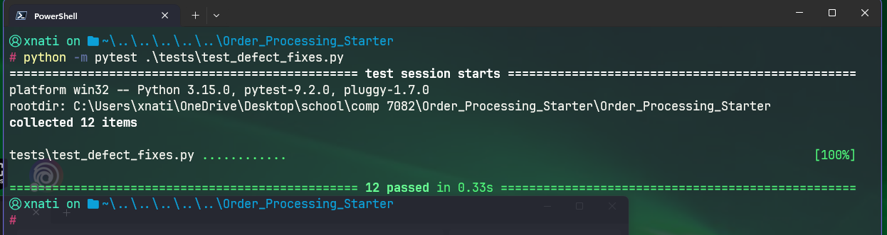
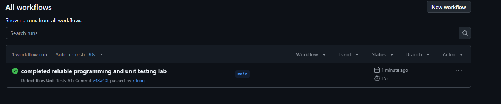
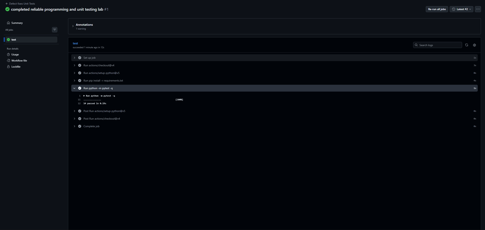

Location: The name of file and function containing the defect \
Defect: What is wrong with the existing code \
Impact: What can happen because of this defect \
Fix: What did I change in the code to correct it 

Defect 1 - \
Location: repository.py , get_product() and get_saved_cart() \
Defect: The defect with this code is that neither of these database operations uses parameterized queries \
Impact: Because this defect exists, it leaves the opportunity open for malicious users to perform SQL injection attacks \
Fix: To fix the code, I used parameterized queries for both database operations. 

Defect 2 - \
Location: repository.py , list_orders() \
Defect: The defect with this code is that it does not use the user_id parameter and instead fetches all orders not just the user's orders \
Impact: Because this defect exists, the user who calls this function could retrieve all the orders that exist instead of only their own \
Fix: To fix the code, I used the user_id parameter to fetch only the specified user's orders 

Defect 3 - \
Location: repository.py , update_stock() \
Defect: The defect with this code is that before executing the statement there is no check to see if the requested quantity exceeds the current stock \
Impact: Because this defect exists, the inventory could be updated to a negative number resulting in incorrect stock values \
Fix: To fix the code, I added a condition that checks whether the requested quantity is less than or equal to the available stock before updating it 

Defect 4 - \
Location: repository.py , all database operation functions \
Defect: The defect with this code is that none of these functions properly handle database errors or ensure the connection is closed if an error occurs \
Impact: Because this defect exists, the application could encounter an error and exit the operation without closing the database connection, potentially causing resource leaks or database locks \
Fix: To fix the code, I wrapped each function's implementation with try-except blocks to handle database errors and close the connection before raising the error again 

Defect 5 - \
Location: cart.py , add_item() and remove_item() \
Defect: The defect with this code is that neither of these functions checks whether the quantity entered is a valid positive integer \
Impact: Because this defect exists, users could add or remove negative quantities, resulting in incorrect cart quantities and totals \
Fix: To fix the code, I added validation that checks whether the quantity is a positive integer before modifying the cart \

Defect 6 - \
Location: cart.py , add_item() \
Defect: The defect with this code is that when adding an existing product, it only checks the new quantity against the available stock and not the total quantity already in the cart \
Impact: Because this defect exists, users could add more products to their cart than what is available in stock \
Fix: To fix the code, I added a check that combines the existing quantity with the new quantity before comparing it with the available stock 

Defect 7 - \
Location: cart.py , total() and apply_discount() \
Defect: The defect with this code is that the discounted total is saved and not recalculated when the cart changes. Applying another discount can also calculate the new discount using the previous discounted total \
Impact: Because this defect exists, users could receive incorrect totals when adding or removing products after applying a discount or when applying multiple discount codes \
Fix: To fix the code, I changed the total function to calculate the discount using the current subtotal and discount code each time 

Defect 8 - \
Location: cart.py , load() \
Defect: The defect with this code is that the load function does not clear the existing cart before loading saved items \
Impact: Because this defect exists, loading the cart multiple times could result in duplicate quantities being added to the cart \
Fix: To fix the code, I cleared the existing cart items before loading the saved items 

